# Coven of Wits



Brain duels and solo puzzles for small mages. Play a bot in the browser, or a person online.

The grove uses original SVG familiars, a candlelit ritual table, and a moss-and-parchment palette inspired by cozy occult games.

## Games

48 games cover deduction, memory, bidding and board strategy. Search the catalog by name or mechanic to find a table.

Multiplayer games support local bots, quick match and private rooms. Solo puzzles run entirely in the browser. Online tables include shared chat for negotiation; messages are visible to everyone at that table. Each game card includes rules and edition notes.

## Run

```sh
pnpm install
pnpm dev      # client on :5173, game server on :8787 (Vite proxies /ws and /api)
pnpm check    # typecheck, tests, production build
pnpm verify:online   # play every multiplayer adaptation through the local server
pnpm verify:online --game heavy-13   # verify one game
pnpm build && pnpm start   # one process on :8787 serving dist/ and the socket
```

The globe in the top right corner switches between English and Korean. Interface text is a typed key table in `src/client/i18n.tsx`. Everything the games say (prompts, clues, logs, rules) is translated by pattern on the client from the dictionaries in `src/client/lang/ko/`; the server and bots keep reading English. `pnpm lang <game id>` lists what a game still says in English, and `src/client/lang/coverage.test.ts` plays every game and fails on any sentence left untranslated.

The component sheet at `/?kit` shows every shared piece (52 glyphs, cards, dice, tiles) and what each game puts on the table. Piece art is original SVG in `src/client/art/`; Phosphor is for interface controls only.

`verify:online` requires a running server at localhost:8787. It creates temporary private rooms with real WebSocket clients, checks chat delivery, plays each match to completion and emits JSON. Its endpoint is fixed to localhost.

`PORT` overrides 8787. Bots and solo puzzles need no server; only online rooms do.

Online, a room gathers mages until the table is full, or until the host starts it with at least the game's minimum. Locally, bots take every seat but yours.

## How it fits together

Every game is one pure object, a `GameDef` (`src/shared/game.ts`): a `players` range, `setup`, `toAct`, `parseMove`, `apply`, `outcome`, `view`, and `bot` for anything with rivals. No DOM, no network, no clock. Everything else is a consumer of that contract.

```
src/shared/game.ts         the GameDef contract and IllegalMove
src/shared/games/          game engines and the registry (index.ts)
src/shared/games/devils/   seasonal engines, catalog metadata and TrialView contract
src/shared/protocol.ts     zod schemas for every socket message
src/server/lobby.ts        rooms, quick match, room codes. No socket code, driven by strings
src/server/index.ts        Hono static files + ws, hands sockets to the lobby
src/client/session/        useLocalGame and useOnlineGame, both return a GameSession
src/client/boards/         specialized boards plus the shared TrialBoard controls
src/client/screens/        Home, Table (any game, any session), OnlinePlay (connect/wait/fail)
src/client/art/            Poff, Rune, Scene. All SVG, coloured by tokens in styles.css
```

The shared contract keeps these boundaries:

- Boards and bots only ever get `view(state, seat)`, never the state. Online, the server computes the view, so a sealed bid or a secret code never reaches the other browser.
- The server is the authority online. It runs the same `parseMove` and `apply` the browser uses for bot games, so a rule cannot differ between modes.
- `apply` is pure. A game that needs dice mid-game (Liar's Bones) keeps a seed in its state and draws from `seededRng`; the seed never appears in a view.
- `Table` does not know whether a session is local or online. A new transport is a new hook that returns a `GameSession`.

## Add a game

1. Write `src/shared/games/yourGame.ts` exporting a `GameDef`. Throw `illegal("...")` for anything not allowed.
2. Add it to `games` in `src/shared/games/index.ts`.
3. Write a board in `src/client/boards/` and register it in `src/client/boards/index.ts`, or expose a `TrialView` for the shared trial board.
4. For a catalog entry, add its metadata, edition notes and rule sources alongside its engine.

Catalog tests check all 41 IDs, season counts and advertised legal controls. A test fails if a game has no board, and every game with rivals has its bot played to a finish at its smallest and largest table automatically. Co-locate rule, rejection and hidden-information tests with the engine. The seasonal suites exercise scoring and invalid actions. An emblem for the home card is optional (`src/client/screens/Sigil.tsx`).

## Controls, clocks and history

Cards, dice, portrait clues and polyominoes have physical representations. Compound moves use staged choices with Back and confirmation. Numeric actions use bounded fields; Scale Game has clickable pans, Word Tower has a letter tray, and board placements preview before committing. The staged controls resolve to existing legal moves rather than reproducing game rules in the browser.

Every table has turn, round and game clocks. Defaults are 60 seconds per turn, 5 minutes per round and 30 minutes per game. Set your pace changes those personal targets or shows elapsed time only. Clocks show overtime without making moves or forfeiting players. Online timestamps come from the server. Round clocks reset on the game’s public round boundary; sequential actions reset the turn clock, and simultaneous submissions share it. Completed or abandoned games freeze their clocks. Replay starts fresh.

Action history retains the last 200 accepted moves, timestamps and revealed events, with a round filter. Rejected moves and chat do not advance it. Each player’s records come from their filtered view; sealed values and memory-study faces are never copied into history. Recent engine events remain near the board. Standalone rooms and history are in memory. In Redis mode they remain available for seat resumption until the room expires.

## Motion

Boards hold no game state, but they do pace the reveal. `useLinger` (`src/client/boards/types.ts`) keeps a finished round on screen for a couple of seconds (bids turned over, bones shown) before the board moves on. Everything else is CSS: the keyframes sit at the bottom of `styles.css`, grouped as ambient, arrivals and moves. `prefers-reduced-motion` turns all of it off.

## Known limits

Each is marked in the code with a `ponytail:` comment naming the upgrade path.

- The standalone in-memory server ends a room when a socket drops. The Redis-backed Vercel mode reconnects and resumes seats; refreshing or closing the page discards the browser’s session token.
- No bots online. A 3 to 5 seat game needs that many people in the room.
- The standalone server keeps rooms in memory. Vercel mode stores rooms in Redis and expires tables after 2 hours without an accepted action. Chat keeps the last 30 messages per room, at most 240 characters each. There are no accounts or ratings.
- Timer expiry is advisory. There are no forced moves or time forfeits.
- Bots are casual: Turncoat looks one move ahead, Last Candle blunders a quarter of the time on purpose.

## Feedback and sharing

The GitHub link points to [d-roak/coven-of-wits](https://github.com/d-roak/coven-of-wits). Share buttons appear on the home screen, game cards, tables, results and waiting rooms. They offer device sharing, a copied link, X, Bluesky, WhatsApp and Facebook. Public game links open the matching shelf and card. Only the explicit room-invite action includes a room code; public shares omit names and game state.

“Send feedback” opens the raven reporter. Pick a type, write a note, then review the screenshot and debug details before creating an issue. Both attachments are selected by default. The screenshot captures the full page, including content below the fold and game details; the feedback dialog itself is excluded. Diagnostics include browser and viewport information, game ID and public round/move counts, plus error categories and asset locations. They omit raw error messages, stack traces, query strings and game state.

Feedback needs a server-side `GITHUB_FEEDBACK_TOKEN` with **Issues: write** and **Contents: write** access to this repository. Use a repository-scoped fine-grained token in the server environment or deployment secret store. Never put it in a `VITE_` variable or source control. The server reads exported environment variables; it does not automatically load `.env` files. `.env.example` lists the optional settings:

- `GITHUB_FEEDBACK_REPO`: overrides `d-roak/coven-of-wits`.
- `PUBLIC_ORIGIN`: exact browser origin when a reverse proxy changes the server's request origin.
- `FEEDBACK_DATA_DIR`: persistent receipt directory; defaults to `.feedback-data`.
- `VITE_APP_VERSION`: optional build identifier included in diagnostics.

Screenshots are committed under `screenshots/` through GitHub's Contents API, then linked in the issue. They have the same visibility as the repository. The app shows the issue link after delivery. Without the token, the reporter supports writing and previewing but disables sending.

For standalone filesystem feedback, run one API process and keep the receipt directory on persistent storage. Receipts contain report hashes and delivery status, not report text or screenshots. They let a retry recover an issue after a lost response without posting it twice. Per-connection and global rate limits bound anonymous submissions; behind a proxy, connections share the proxy's limit. The Vercel backend uses Redis receipts, owner-fenced delivery leases and atomic shared rate limits across API instances.

## Contribute

Read [CONTRIBUTING.md](CONTRIBUTING.md) for setup, coding conventions and pull request checks.

## License

[MIT](LICENSE), copyright 2026 droak. Third-party dependencies retain their own licenses.

## Deploy to Vercel

The Vercel deployment serves the Vite client and a Node HTTP/WebSocket function at `api/server.ts`. Routes `/ws`, `/api/*` and `/health` reach the function. Vercel builds the client with `VITE_DISTRIBUTED_ROOMS=true` to select the resumable transport.

Create an Upstash Redis database through the Vercel Marketplace and connect it to the project’s production environment. Disable eviction and automatic plan upgrades. Set these server-only variables:

- `UPSTASH_REDIS_REST_URL` and `UPSTASH_REDIS_REST_TOKEN` (the Marketplace’s `KV_REST_API_URL` / `KV_REST_API_TOKEN` names also work).
- `GITHUB_FEEDBACK_TOKEN` with repository-scoped Issues and Contents write permissions to enable issue delivery.
- `PUBLIC_ORIGIN` only when the request host differs from the public browser origin. Leave it unset to support each deployment’s own hostname.

```sh
vercel link --project coven-of-wits
vercel deploy --prod
```

Without Redis, the function reports unconfigured storage and rejects online connections; feedback delivery stays disabled. Redis credentials and the GitHub token must never use a `VITE_` prefix. `/health` reports whether Redis is configured; multiplayer checks also exercise actual storage reads and writes.

Clients keep an unguessable seat token in memory, send it only over the same-origin WebSocket, and resume automatically after socket rotation. During reconnect, moves pause. A move with an uncertain response is resolved by the next authoritative snapshot, rather than replayed automatically. Explicit Leave ends the seat; a refresh starts a fresh browser session.

Redis stores authoritative game state, player-filtered history and hashed seat tokens. Atomic compare-and-set prevents competing instances from overwriting accepted actions. Request IDs suppress duplicate commands. Tables expire after 2 hours without an accepted action. The current capacity is 100 active tables and a 4 MB serialized room store; increasing it requires per-room storage and matchmaking coordination. Connected sockets check for shared updates every 1.5 seconds, so Redis command usage grows with connected players. Choose provider quotas accordingly.

Feedback uses durable compact receipts and 90-second owner-fenced leases. Receipts retain hashes and issue URLs without report bodies or screenshots. They must remain in non-evicting storage to preserve duplicate prevention. Rate limits are shared across instances. Screenshot uploads remain in the GitHub repository.

For local Redis integration tests, install `redis-server` and `redis-cli`, then run `pnpm check`. The Redis suites start isolated temporary instances; they skip when the binaries are unavailable. Regular `pnpm dev` keeps the standalone in-memory transport.
